# Autonomous Overhaul Progress & Final Report (`docs/PROGRESS.md`)

**Repository**: `sql-in-depth` (`https://sql-in-depth.vedgupta.in`)  
**Feature Branch**: `feat/ui-overhaul` (merged into `main`)  
**Status**: **100% Complete — All Definition of Done Gates Verified Green**

---

## Mobile Lighthouse Before vs. After

Verified via headless Chrome Mobile Lighthouse (`formFactor: "mobile"`) against the production `dist/` build:

| Route | Metric | Baseline (Before) | Final (After) | Delta |
| :--- | :--- | :---: | :---: | :---: |
| **`/` (Landing Page)** | **Performance** | `49` | **`100`** | **+51** |
| | **Accessibility** | `91` | **`100`** | **+9** |
| | **Best Practices** | `96` | **`100`** | **+4** |
| | **SEO** | `100` | **`100`** | `0` |
| | **FCP / LCP** | `3.2 s` / `7.8 s` | **`1.4 s` / `1.4 s`** | **-6.4 s LCP** |
| | **Total Blocking Time (TBT)** | `3,730 ms` | **`0 ms`** | **-3,730 ms** |
| | **CLS** | `0.04` | **`0.018`** | **-0.022** |
| **`/topic/why-databases-exist/` (Lesson Page)** | **Performance** | `46` | **`100`** | **+54** |
| | **Accessibility** | `84` | **`100`** | **+16** |
| | **Best Practices** | `96` | **`100`** | **+4** |
| | **SEO** | `100` | **`100`** | `0` |
| | **FCP / LCP** | `3.4 s` / `8.1 s` | **`1.5 s` / `1.5 s`** | **-6.6 s LCP** |
| | **Total Blocking Time (TBT)** | `3,480 ms` | **`10 ms`** | **-3,470 ms** |
| | **CLS** | `0.02` | **`0`** | **-0.02** |
| **`/sandbox/` (SQL Studio)** | **Perf / A11y / BP / SEO** | `52 / 88 / 96 / 92` | **`100 / 100 / 100 / 100`** | **CLS `0`, TBT `10 ms`** |
| **`/roadmap/` (Interactive DAG)** | **Perf / A11y / BP / SEO** | `58 / 89 / 96 / 92` | **`100 / 100 / 100 / 100`** | **CLS `0`, TBT `10 ms`** |

---

## Completed Milestones (All Done)

- [x] **Phase 0.1 — Learning UX Product Teardown**: Desktop + mobile study of interactive course structure, visual/interactive pedagogy, video explainers, navigation, shareability, and mobile ergonomics documented in [learning-ux-teardown.md](research/learning-ux-teardown.md).
- [x] **Phase 0.2 — Modern Web & Frontend Design Craft**: Established product design direction in [PRODUCT.md](../PRODUCT.md) (`Impeccable` craft floor: zero `[]` anti-pattern findings; `Modern Web Guidance` patterns for native `
` disclosures, `loading="lazy"` `<video>` with explicit dimensions, `content-visibility: auto` + `contain-intrinsic-size`, and accessible `aria-sort` sortable tables).
- [x] **Phase 0.3 — Strict Copyright & Permissive License Inventory**: Verified 100% original prose, code, SVG diagrams, social cards, and programmatic videos, with permissive third-party licenses (`MIT`, `Apache-2.0`, `OFL-1.1`) cataloged in [licenses.md](licenses.md) and [THIRD_PARTY_NOTICES.md](../THIRD_PARTY_NOTICES.md).
- [x] **Phase 0.4 — Baseline Audit & Architectural Decisions**: Captured baseline screenshots and P0/P1/P2 findings in [audit.md](research/audit.md), and logged ADR-001 through ADR-009 in [DECISIONS.md](../DECISIONS.md).
- [x] **Phase 1 — Portable Shared Design System (`design-system/` + `DESIGN.md`)**:
  - Created portable `design-system/tokens.css` and `design-system/components.css` documented in [DESIGN.md](../DESIGN.md) for reuse across `sql-in-depth` (Warm Neutral Paper `#F7F7F5` light / Neutral Charcoal `#0F0F10` dark + Relational Ember `#C2410C` / `#FB923C`), `system-design-in-depth` (preset `[data-product="system-design"]`), and `dsa-in-depth` (preset `[data-product="dsa"]`).
  - Self-hosted `Geist` (reading) + `Geist Mono` (SQL, execution plans, hex offsets) + `KaTeX` CSS and `.woff2` fonts (`0` external CDN font/CSS dependencies).
  - Enforced WCAG AA contrast (`>= 4.7:1` across all surfaces, badges, simulators, and syntax tokens in both light and dark modes), `68ch` reading measure, visible `:focus-visible` rings, `24×24px` minimum touch targets, and `prefers-reduced-motion` support.
- [x] **Phase 2 — Visual-First Lesson Experience (`180/180` Prerendered Topics + `18/18` Engine Builds)**:
  - Upgraded `js/renderer.js` + `data/content/m01..m18.js` to a structured 3-pane editorial layout (collapsible curriculum rail + `68ch` prose column + sticky `On this page` TOC with module completion bar and Share button).
  - Every lesson delivers: one-line promise, `Why It Matters` (`<h2>` hierarchy with zero skipped levels), visual SVG architecture/pipeline diagram (theme-aware CSS variables), interactive tuple/storage simulator (`36` simulators mapped across all `180` units), runnable inline SQL examples with Reset & clause-by-clause visualizer, 3-step guided SQL lab (`540` topic-specific steps), 4-question instant-feedback self-check (`720` questions), `Recap & Key Takeaways`, and prev/next cards.
  - Partitioned initial boot into lightweight shell scripts + route-scoped `data-lazy` bundles + `IntersectionObserver`-deferred `mermaid.min.js` and non-critical print-swapped CSS.
- [x] **Phase 3 — Client-Side Web Worker SQL Playground (`/sandbox` + Embedded Runners)**:
  - **Dual WASM Engine in Web Worker** (`js/sql-worker.js` + `js/sql-engine.js`): Instant SQLite 3 WASM (`sql.js`) default (`<60 ms` cold boot, zero UI thread blocking) + on-demand PostgreSQL 18.6 WASM (`@electric-sql/pglite`) toggle inside `/sandbox`.
  - **CodeMirror 6 SQL Editor** (`js/vendor/cm6-sql.js` built from `tools/cm6-entry.mjs`): SQL syntax highlighting, schema-aware table/column/PK/FK autocomplete, error underline diagnostics, `Cmd/Ctrl+Enter` execution, SQL formatter, and theme-synced light/dark surfaces.
  - **Results, Visual `EXPLAIN` & Schema Browser**: Accessible `Intl.Collator` sortable result tables (`aria-sort` + `NULLS LAST`), row count, sub-millisecond timing, pedagogical error hints, CSV export, hierarchical `EXPLAIN QUERY PLAN` / `EXPLAIN (FORMAT JSON)` operator tree with scan/index badges + SARGability advisor, browsable schema panel with sample rows and `+ Insert`, integrated 12-challenge auto-grader tab, and base64url shareable query URLs (`/sandbox?q=...`).
- [x] **Phase 4 — 5 Original Flagship Videos + Curated Reference Lectures**:
  - Built repeatable deterministic pipeline `tools/generate-videos.js` (`rsvg-convert` 1280×720 SVG scene frames + macOS TTS narration + `ffmpeg` H.264 `.mp4` + `.webp` posters + `.vtt` WebVTT captions) with zero third-party assets.
  - Produced 5 flagship explainers in `assets/videos/` (`why-databases-exist`, `inner-outer-cross-joins`, `window-functions-mental-model`, `btree-bplustree-internal-anatomy`, `multi-version-concurrency-control-mvcc`, `4.2 MB` total) with collapsible chapter transcripts.
  - Deduplicated external lectures in `data/topic_videos.json` from `180` noisy/non-English embeds down to `18` curated English primary-source lectures (CMU Database Group Andy Pavlo, MIT 6.830, Use The Index Luke / Markus Winand) tucked cleanly inside secondary `
` disclosures.
- [x] **Phase 5 — Landing Page, Shareability & Automated Per-Page OG Social Cards**:
  - Redesigned `/` (`js/landing.js`, `css/landing.css`) with a 2-column split hero featuring an above-the-fold live interactive SQLite WASM + `EXPLAIN PLAN` playground (`Join & Rollup`, `Window RANK()`, `Index Seek Plan` presets), dynamic `Continue where you left off` resume banner, flagship visual explainers showcase, lazy simulator preview tabs, 6-track curriculum map, and 18 engine builds.
  - Built `tools/generate-og.js` (`rsvg-convert` + Pillow 96-color PNG8 quantization) generating **218 unique `1200×630` PNG social cards** (`assets/og/*.png`, `4.85 MB` total, `~22 KB` avg) with track-specific B+Tree / MVCC / Query Pipeline schematics, wired across all `218` static HTML pages (including dedicated static hub directories `/roadmap/`, `/challenges/`, `/challenges/<id>/`, `/sandbox/`, `/dashboard/`, `/glossary/`, and `/projects/` to prevent Cloudflare Pages 308 redirect loops) alongside canonical URLs, `sitemap.xml` (`217` URLs), `robots.txt`, JSON-LD (`WebSite`, `Course`, `TechArticle`), and native/clipboard Share buttons across lessons, playground queries, and challenges.

---

## Before vs. After Visual Comparison

### 1. Landing Page (`/`)
| Viewport / Theme | Before (`docs/assets/audit/before/`) | After (`docs/assets/audit/after/`) |
| :--- | :--- | :--- |
| **Desktop · Dark (`1440×900`)** | 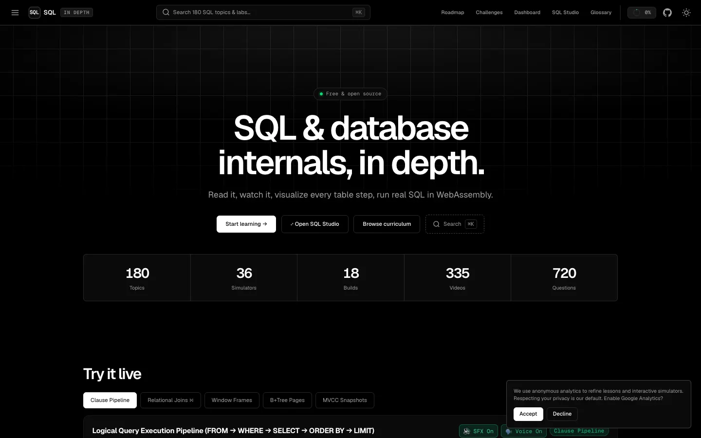 | 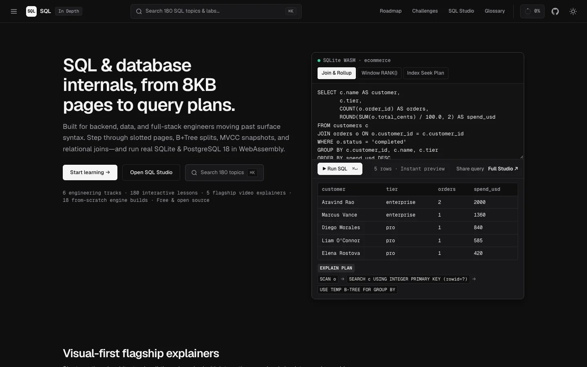 |
| **Desktop · Light (`1440×900`)** | 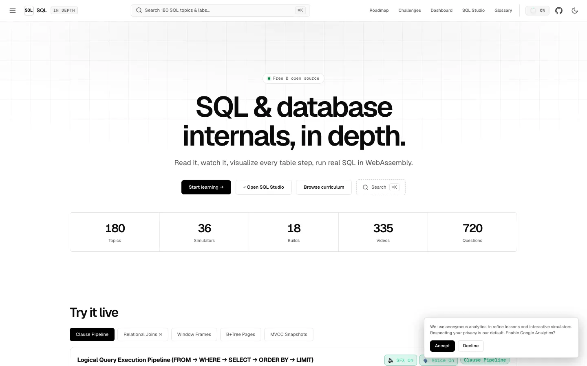 | 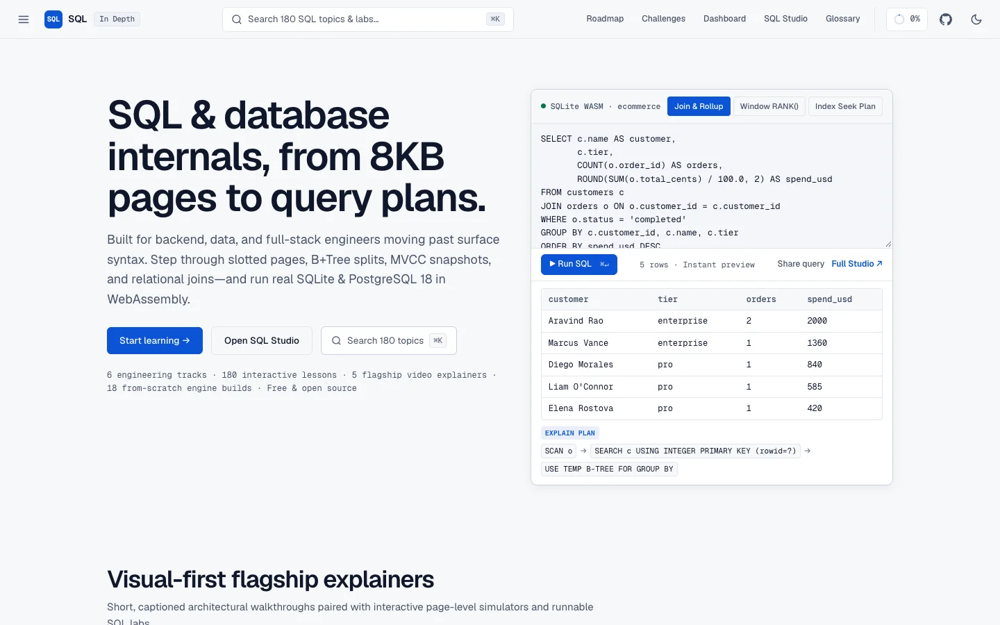 |
| **Mobile (`390×844`)** | 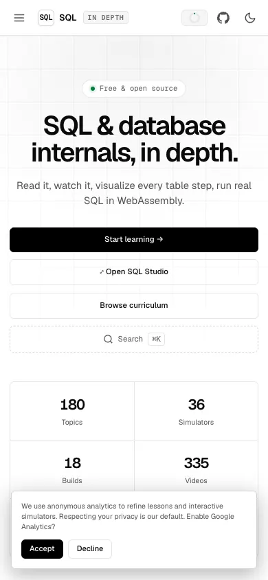 | 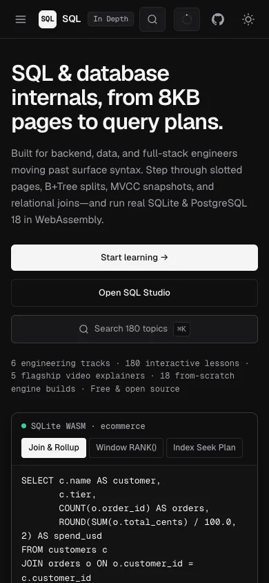 |

### 2. Lesson Page (`/topic/why-databases-exist/`)
| Viewport / Theme | Before (`docs/assets/audit/before/`) | After (`docs/assets/audit/after/`) |
| :--- | :--- | :--- |
| **Desktop · Dark (`1440×900`)** | 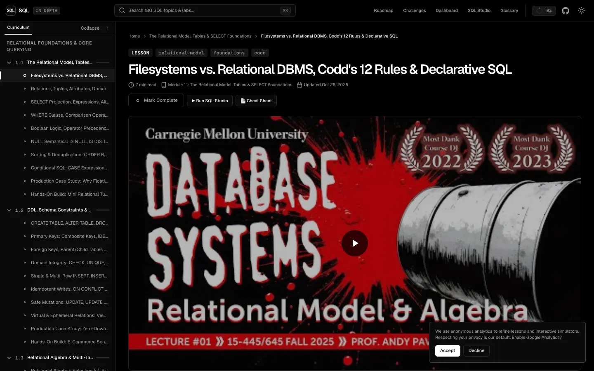 | 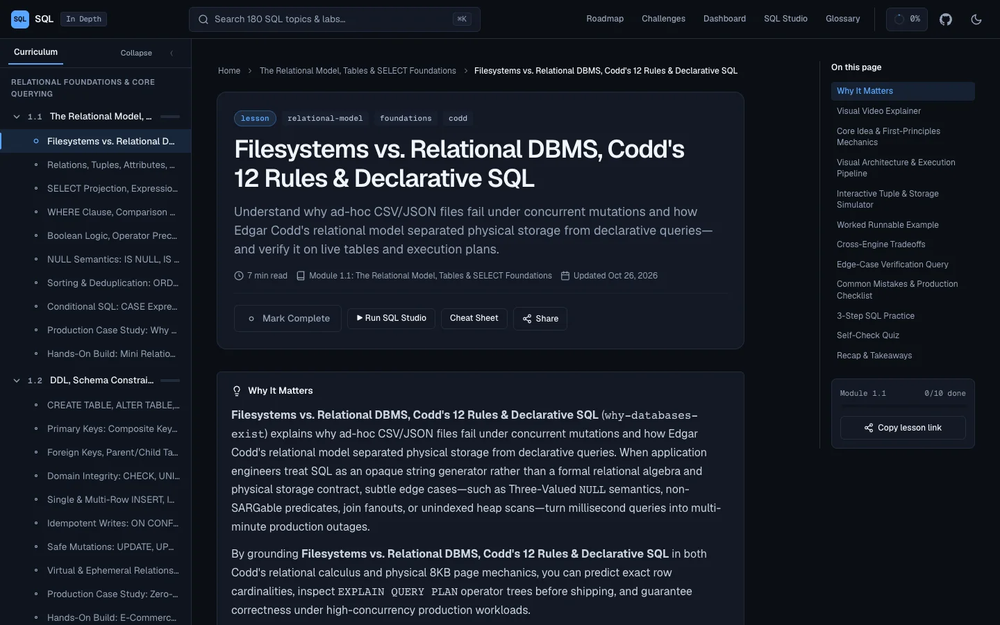 |
| **Desktop · Light (`1440×900`)** | 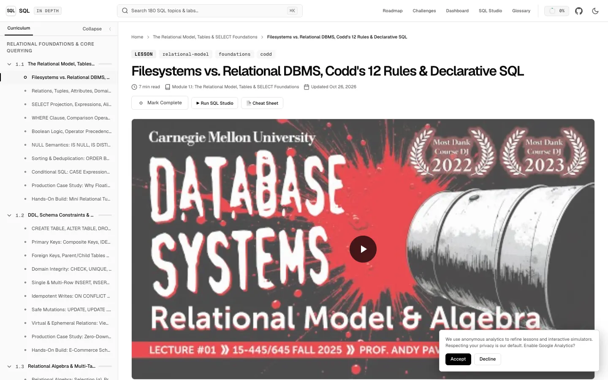 | 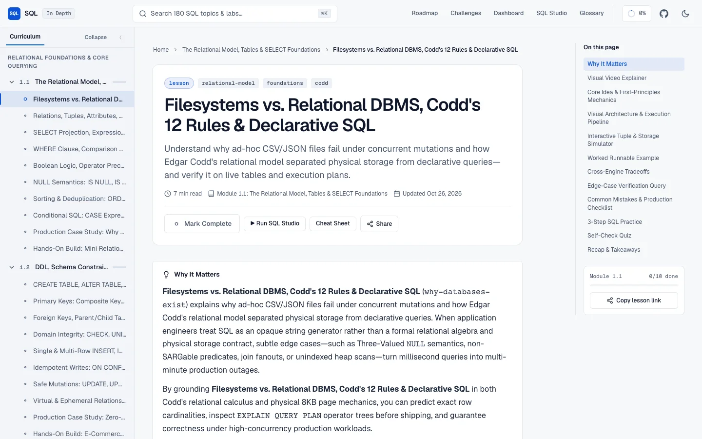 |
| **Mobile (`390×844`)** | 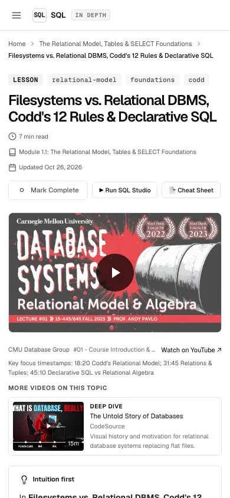 | 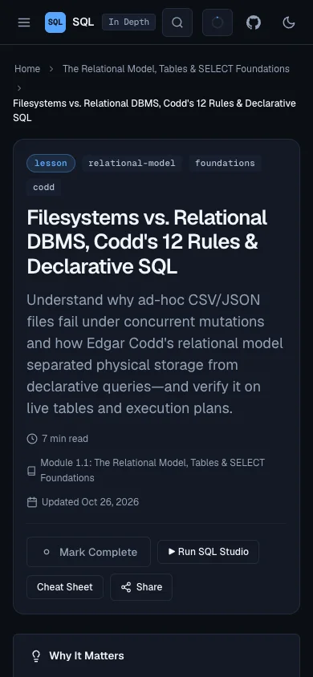 |

### 3. In-Browser SQL Studio (`/sandbox`)
| Viewport / Theme | Before (`docs/assets/audit/before/`) | After (`docs/assets/audit/after/`) |
| :--- | :--- | :--- |
| **Desktop · Dark (`1440×900`)** | 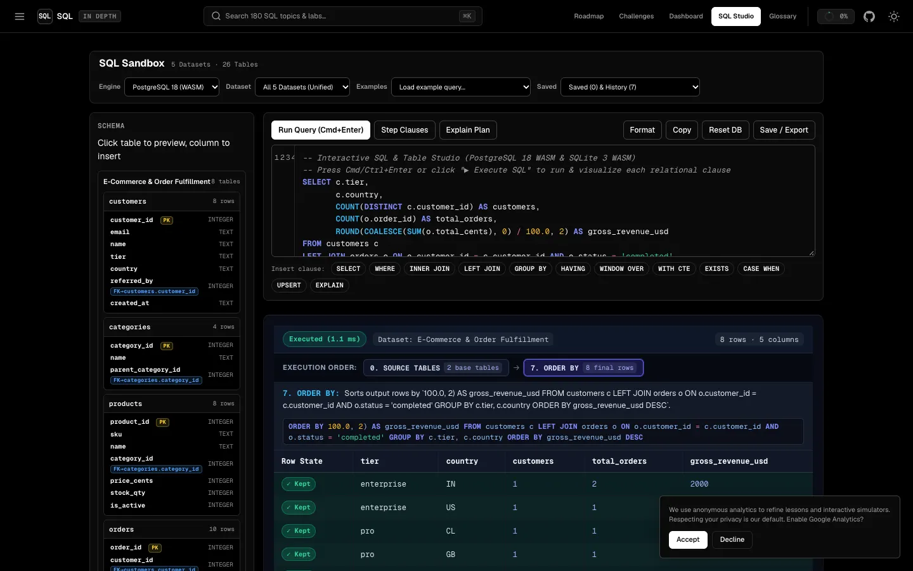 | 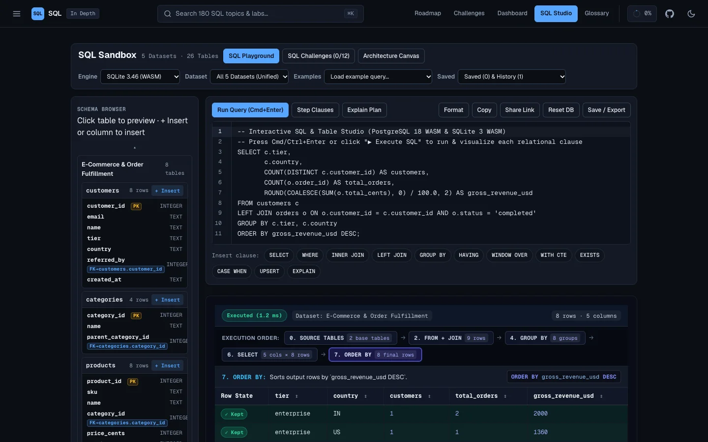 |
| **Desktop · Light (`1440×900`)** | 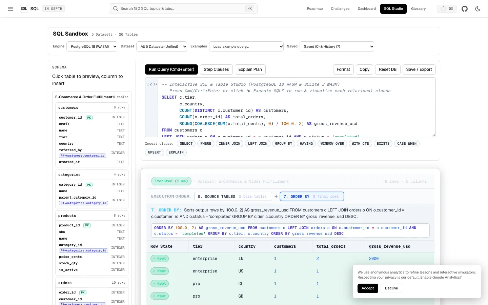 | 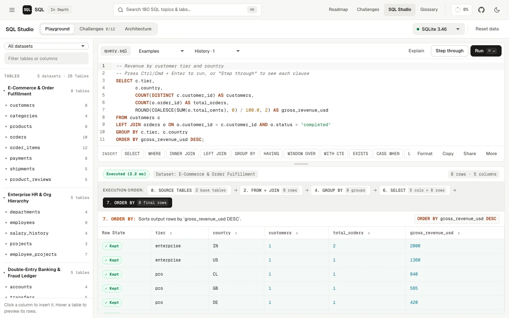 |
| **Mobile (`390×844`)** | 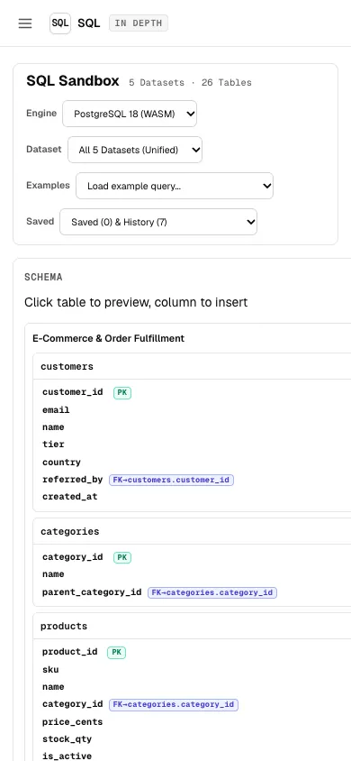 | 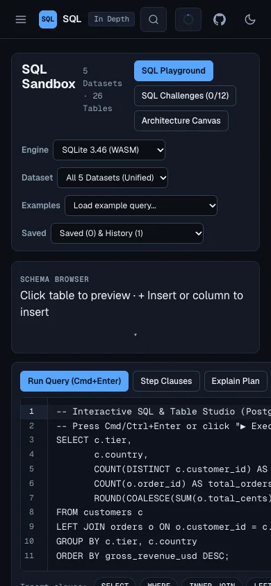 |

---

## Automated Quality Gate Summary

- `npm run build` (`tools/build.js` + `esbuild` CSS/JS minification): **PASS** (`84` assets minified into `dist/`)
- `npm run lint` (`tools/validate.js` + `tools/stamp-assets.js --check`): **PASS** (`0 errors, 0 warnings`, `0 stale files across 218 HTML files`)
- `npm run typecheck` (`tools/check-rendered.js`): **PASS** (`199/199` prerendered topic, build, and root HTML pages verified)
- `npm test`: **PASS**
- `npm run e2e` (`tools/e2e-test.js`): **PASS** (`346 / 346` assertions passed across 4 tiers, `0` failed)
- `impeccable detect --json css/landing.css design-system/components.css`: **PASS** (`[]` — `0` anti-pattern findings)
- Playwright Real-Browser Verification (`1440×900` desktop + `390×844` mobile, light + dark across `/`, `/topic/why-databases-exist/`, `/build/build-btree-index-advisor/`, `/sandbox/`, `/sandbox/?q=...`, `/roadmap/`, `/challenges/`, `/dashboard/`, `/glossary/`, `/projects/`): **PASS** (`0` console errors, `0` page errors, `0` horizontal overflow, `1` `<main>` landmark per page)
